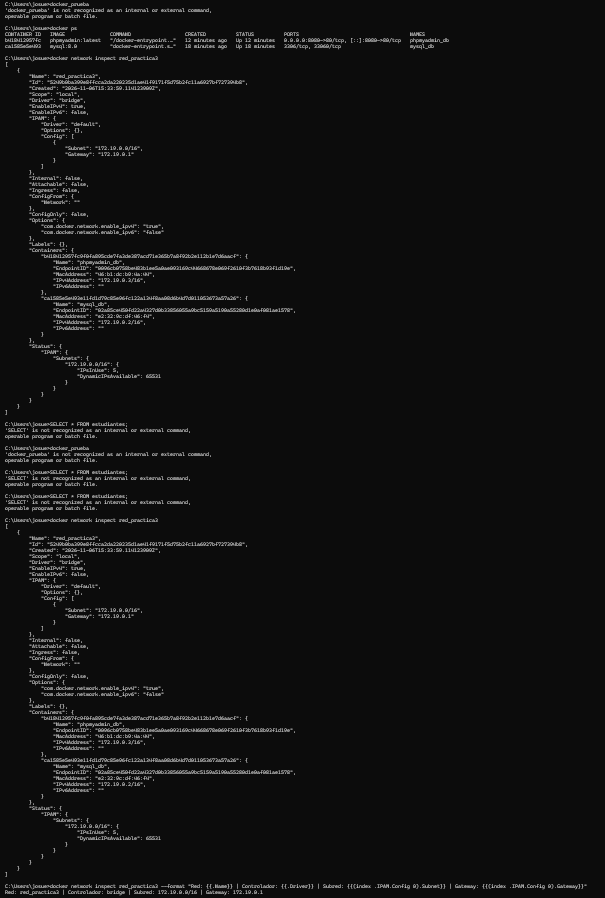
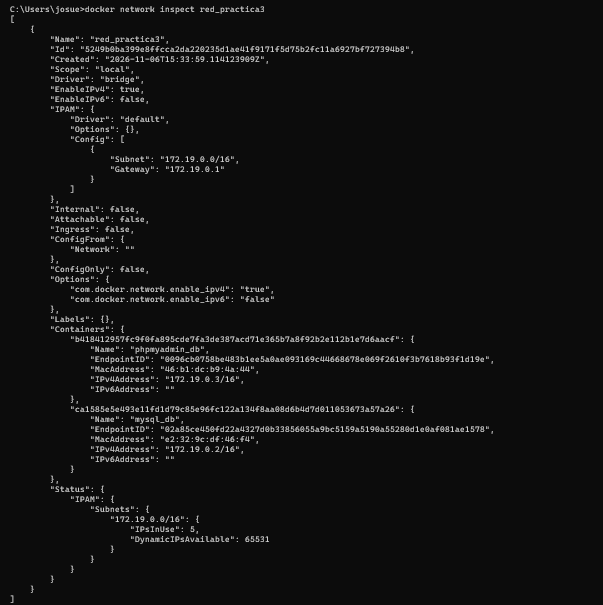
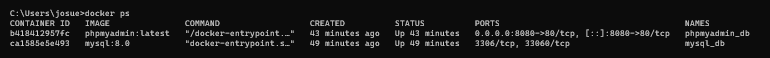
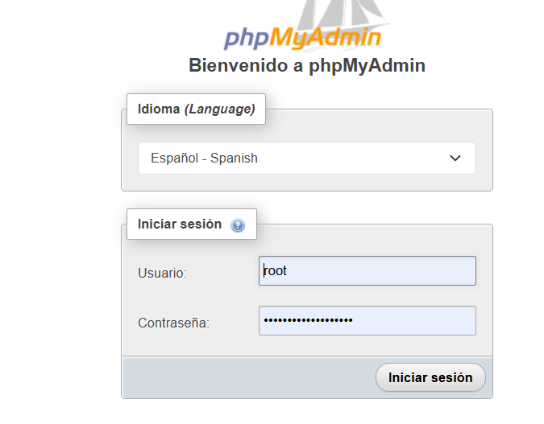
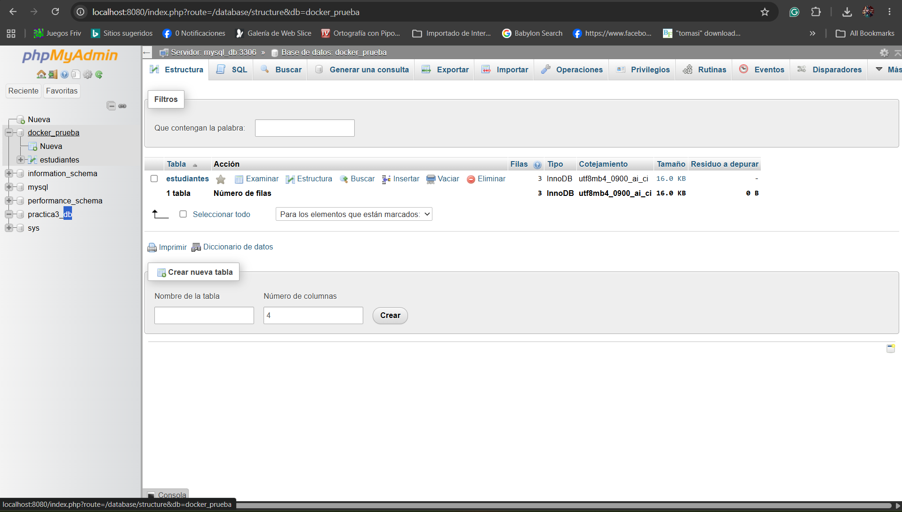
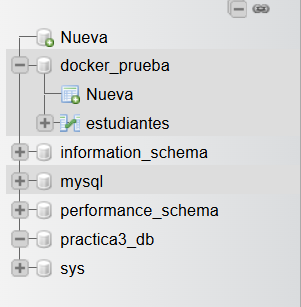
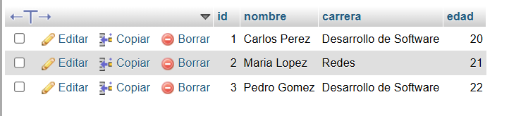
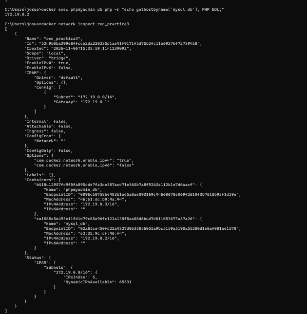

# Práctica N.º 3: Implementación de MySQL y phpMyAdmin mediante Docker

**Institución:** Instituto Tecnológico Superior Particular Sudamericano  
**Carrera:** Tecnología Superior en Desarrollo de Software  
**Estudiante:** Marcelo Josué Albán Guzmán  
**Fecha:** 6 de noviembre de 2026  
**Tema:** Configuración de contenedores MySQL y phpMyAdmin mediante una red personalizada de Docker.

---

## 1. Resumen

En esta práctica se realizó la configuración de dos contenedores Docker para ejecutar los servicios de MySQL y phpMyAdmin. El objetivo principal fue establecer una comunicación entre ambos mediante una red personalizada, permitiendo administrar el servidor de base de datos desde una interfaz web.

Para ello, se creó una red denominada `red_practica3` utilizando el controlador `bridge`. Posteriormente, se configuró el contenedor MySQL con sus respectivas variables de entorno y se implementó phpMyAdmin, estableciendo la conexión entre ambos servicios.

Durante las verificaciones se comprobó que los contenedores estaban en ejecución y conectados a la misma red. Además, se accedió correctamente a phpMyAdmin, donde se visualizaron las bases de datos disponibles en el servidor MySQL.

## 2. Introducción

Docker permite ejecutar aplicaciones y servicios dentro de contenedores independientes, facilitando su implementación y administración sin necesidad de instalar todos sus componentes directamente en el sistema operativo.

En el desarrollo de software es común trabajar con diferentes servicios que necesitan comunicarse entre sí. Un ejemplo es MySQL, utilizado para almacenar y gestionar información, junto con phpMyAdmin, que proporciona una interfaz gráfica para administrar bases de datos.

En esta práctica se implementaron ambos servicios utilizando contenedores Docker. Para permitir su comunicación, se configuró una red personalizada de tipo `bridge`, mediante la cual los contenedores pueden identificarse utilizando sus nombres.

A través de esta actividad se fortalecieron los conocimientos relacionados con la creación de contenedores, la configuración de redes, el uso de variables de entorno y la administración de bases de datos en entornos virtualizados mediante contenedores.

## 3. Objetivos

### 3.1. Objetivo general

Implementar un entorno de administración de bases de datos mediante contenedores Docker, utilizando MySQL y phpMyAdmin conectados a través de una red personalizada.

### 3.2. Objetivos específicos

- Crear una red personalizada en Docker para permitir la comunicación entre contenedores.
- Configurar un contenedor MySQL mediante variables de entorno.
- Implementar un contenedor phpMyAdmin para administrar MySQL desde el navegador.
- Establecer la conexión entre ambos servicios mediante la red personalizada.
- Verificar el funcionamiento de los contenedores y su conectividad.
- Documentar el procedimiento realizado mediante comandos, explicaciones y evidencias gráficas.
## 4. Marco teórico

### 4.1. Docker

Docker es una plataforma que permite desarrollar, distribuir y ejecutar aplicaciones mediante contenedores. Estos contenedores funcionan como entornos aislados que incluyen los componentes necesarios para ejecutar un servicio.

Una de sus principales ventajas es que permite trabajar con diferentes aplicaciones sin tener que instalarlas directamente en el sistema operativo. Además, facilita la administración de los servicios y permite reproducir configuraciones en otros equipos.

### 4.2. Contenedores Docker

Un contenedor es una instancia en ejecución de una imagen Docker. Cada contenedor puede ejecutar un servicio específico, como un servidor web, una base de datos o una aplicación.

En esta práctica se utilizaron dos contenedores independientes: uno para ejecutar MySQL y otro para phpMyAdmin. Esta separación permitió administrar ambos servicios individualmente y establecer su comunicación mediante una red compartida.

### 4.3. Imágenes Docker

Las imágenes Docker contienen los archivos, dependencias y configuraciones necesarias para crear contenedores.

Para esta actividad se utilizaron las imágenes `mysql:8.0` y `phpmyadmin:latest`, obtenidas desde Docker Hub.

### 4.4. Redes Docker

Las redes Docker permiten establecer la comunicación entre contenedores y otros servicios.

Docker dispone de diferentes controladores de red. Uno de los más utilizados es `bridge`, que permite conectar varios contenedores dentro de una misma máquina.

En esta práctica se creó la red personalizada `red_practica3`. Gracias a esta configuración, phpMyAdmin pudo comunicarse con MySQL utilizando el nombre del contenedor `mysql_db`, sin necesidad de conocer manualmente su dirección IP.

### 4.5. MySQL

MySQL es un sistema de gestión de bases de datos relacionales que permite almacenar, organizar y consultar información mediante el lenguaje SQL.

Se utiliza en aplicaciones web y sistemas informáticos que necesitan administrar información estructurada.

Durante esta práctica, MySQL se ejecutó dentro de un contenedor Docker y se configuró mediante variables de entorno para establecer las credenciales de acceso y crear una base de datos inicial.

### 4.6. phpMyAdmin

phpMyAdmin es una herramienta de administración de bases de datos MySQL y MariaDB que funciona mediante una interfaz web.

Permite realizar operaciones como crear bases de datos, administrar tablas, insertar registros y ejecutar consultas SQL desde el navegador.

En esta actividad se utilizó phpMyAdmin para acceder al servidor MySQL alojado en otro contenedor Docker, comprobando así la comunicación entre ambos servicios.

### 4.7. Variables de entorno

Las variables de entorno permiten establecer parámetros de configuración al momento de crear un contenedor.

En MySQL se utilizaron para definir el usuario administrador, su contraseña, un usuario adicional y la base de datos inicial.

En phpMyAdmin se configuró la variable `PMA_HOST` para indicar el nombre del contenedor MySQL al que debía conectarse.

### 4.8. Puertos y comunicación entre contenedores

Los puertos permiten que las aplicaciones reciban conexiones de otros servicios o equipos.

En esta práctica, phpMyAdmin utilizó el puerto `80` dentro de su contenedor, el cual fue vinculado al puerto `8080` del equipo mediante el parámetro `-p 8080:80`.

De esta manera, se pudo acceder a la interfaz web desde la dirección `http://localhost:8080`.

Por su parte, MySQL utilizó el puerto `3306` para recibir conexiones desde phpMyAdmin a través de la red interna de Docker.

## 5. Herramientas utilizadas

| Herramienta | Descripción |
|---|---|
| Docker Desktop | Plataforma utilizada para administrar los contenedores. |
| Docker CLI | Interfaz de comandos utilizada para crear y verificar contenedores y redes. |
| MySQL 8.0 | Sistema gestor de bases de datos relacionales. |
| phpMyAdmin | Herramienta web para administrar MySQL. |
| CMD de Windows | Terminal utilizada para ejecutar los comandos Docker. |
| Navegador web | Utilizado para acceder a phpMyAdmin mediante localhost. |
| Visual Studio Code | Editor para elaborar el informe en formato Markdown. |

Estas herramientas permitieron implementar un entorno de base de datos basado en contenedores, configurar su comunicación y verificar su funcionamiento.
## 6. Desarrollo de la práctica

### 6.1. Creación de una red personalizada en Docker

Para comenzar la práctica, se verificó el funcionamiento de Docker mediante la terminal de Windows. Posteriormente, se creó una red personalizada que permitiría establecer la comunicación entre los contenedores MySQL y phpMyAdmin.

La red fue configurada utilizando el controlador `bridge`, el cual permite que varios contenedores se comuniquen dentro de un mismo entorno Docker.

**Paso 1. Verificación de Docker**

Se utilizó el siguiente comando para comprobar los contenedores que se encontraban en ejecución:

```bash
docker ps
```

Este comando permite visualizar información sobre los contenedores activos, como sus nombres, imágenes, estados y puertos.

**Paso 2. Creación de la red personalizada**

Se ejecutó el siguiente comando:

```bash
docker network create red_practica3
```

Este comando permitió crear una red denominada `red_practica3`, que posteriormente se utilizó para conectar ambos servicios.

**Paso 3. Verificación de la red**

Para comprobar que la red se había creado correctamente, se utilizó:

```bash
docker network ls
```

Después se ejecutó:

```bash
docker network inspect red_practica3
```

Este último comando permitió consultar la configuración de la red, incluyendo el controlador utilizado, la subred y la puerta de enlace.

Durante la verificación se identificaron los siguientes parámetros:

| Parámetro | Valor |
|---|---|
| Nombre de la red | red_practica3 |
| Controlador | bridge |
| Subred | 172.19.0.0/16 |
| Puerta de enlace | 172.19.0.1 |

**Figura 1. Configuración de la red personalizada en Docker.**



*Fuente: Elaboración propia mediante la terminal de Windows.*

**Resultado obtenido:**

La red `red_practica3` se creó correctamente y quedó disponible para conectar los contenedores de MySQL y phpMyAdmin. Inicialmente, la red no tenía contenedores asociados, debido a que estos se configurarían en los siguientes pasos.

### 6.2. Creación y configuración del contenedor MySQL

Una vez creada la red personalizada, se procedió a implementar el contenedor correspondiente al servidor de base de datos MySQL.

Para ello, se utilizó la imagen oficial de MySQL 8.0 disponible en Docker Hub. Durante su configuración se establecieron las credenciales de acceso, una base de datos inicial y un volumen para conservar la información almacenada.

**Paso 1. Descarga de la imagen MySQL**

Se ejecutó el siguiente comando para obtener la imagen:

```bash
docker pull mysql:8.0
```

Este comando descarga la imagen de MySQL 8.0 desde Docker Hub para utilizarla posteriormente en la creación del contenedor.

**Paso 2. Creación del contenedor MySQL**

Se utilizó el siguiente comando:

```bash
docker run -d --name mysql_db --network red_practica3 -e MYSQL_ROOT_PASSWORD=Root2026_Practica3! -e MYSQL_DATABASE=practica3_db -e MYSQL_USER=estudiante -e MYSQL_PASSWORD=Estudiante2026! -v mysql_practica3_data:/var/lib/mysql mysql:8.0
```

Mediante este comando se creó un contenedor denominado `mysql_db`, conectado directamente a la red personalizada `red_practica3`.

Los parámetros principales utilizados fueron:

| Parámetro | Descripción |
|---|---|
| `-d` | Ejecuta el contenedor en segundo plano. |
| `--name mysql_db` | Asigna un nombre al contenedor. |
| `--network red_practica3` | Conecta MySQL a la red personalizada. |
| `MYSQL_ROOT_PASSWORD` | Define la contraseña del administrador. |
| `MYSQL_DATABASE` | Crea la base de datos inicial `practica3_db`. |
| `MYSQL_USER` | Define un usuario adicional. |
| `MYSQL_PASSWORD` | Establece la contraseña del usuario adicional. |
| `-v` | Configura un volumen para conservar los datos. |
| `mysql:8.0` | Indica la imagen utilizada. |

**Paso 3. Verificación del contenedor**

Para comprobar que MySQL se encontraba en ejecución, se utilizó:

```bash
docker ps
```

Posteriormente, se inspeccionó la red mediante:

```bash
docker network inspect red_practica3
```

Durante esta verificación se identificó que el contenedor `mysql_db` se encontraba conectado a la red y tenía asignada la dirección IP interna `172.19.0.2`.

**Figura 2. Verificación del contenedor MySQL en Docker.**



*Fuente: Elaboración propia mediante Docker CLI.*

**Resultado obtenido:**

El contenedor MySQL se configuró correctamente y quedó conectado a la red `red_practica3`. Asimismo, se comprobó que Docker le asignó una dirección IP interna, permitiendo que otros contenedores conectados a la misma red puedan comunicarse con el servidor de base de datos.

### 6.3. Creación y configuración del contenedor phpMyAdmin

Después de configurar el contenedor MySQL, se procedió a implementar phpMyAdmin, una herramienta que permite administrar bases de datos desde una interfaz web.

Para establecer la comunicación entre ambos servicios, se conectó phpMyAdmin a la misma red personalizada `red_practica3`.

**Paso 1. Descarga de la imagen phpMyAdmin**

Se ejecutó el siguiente comando:

```bash
docker pull phpmyadmin:latest
```

Este comando permitió obtener la imagen oficial de phpMyAdmin desde Docker Hub.

**Paso 2. Creación del contenedor phpMyAdmin**

Posteriormente, se ejecutó:

```bash
docker run -d --name phpmyadmin_db --network red_practica3 -e PMA_HOST=mysql_db -e PMA_PORT=3306 -p 8080:80 phpmyadmin:latest
```

Mediante este comando se creó el contenedor `phpmyadmin_db`, configurándolo para establecer una conexión con el servidor MySQL.

Los parámetros principales utilizados fueron:

| Parámetro | Descripción |
|---|---|
| `-d` | Ejecuta el contenedor en segundo plano. |
| `--name phpmyadmin_db` | Asigna el nombre al contenedor. |
| `--network red_practica3` | Conecta phpMyAdmin a la red personalizada. |
| `PMA_HOST=mysql_db` | Indica el nombre del contenedor MySQL. |
| `PMA_PORT=3306` | Establece el puerto utilizado por MySQL. |
| `-p 8080:80` | Permite acceder a phpMyAdmin desde el navegador. |
| `phpmyadmin:latest` | Especifica la imagen utilizada. |

**Paso 3. Verificación de los contenedores**

Para comprobar que ambos servicios se encontraban en ejecución, se utilizó:

```bash
docker ps
```

Este comando permitió verificar que los contenedores `mysql_db` y `phpmyadmin_db` estaban activos.

**Figura 3. Verificación de los contenedores MySQL y phpMyAdmin.**



*Fuente: Elaboración propia mediante Docker CLI.*

**Paso 4. Acceso a la interfaz web**

Una vez iniciado el contenedor phpMyAdmin, se abrió el navegador y se ingresó a la siguiente dirección:

`http://localhost:8080`

Se presentó la pantalla de inicio de sesión de phpMyAdmin, donde se utilizaron las credenciales configuradas previamente para acceder al servidor MySQL.

**Figura 4. Pantalla de inicio de sesión de phpMyAdmin.**



*Fuente: Elaboración propia mediante phpMyAdmin.*

**Paso 5. Comprobación de la conexión con MySQL**

Después de iniciar sesión, se accedió correctamente al panel principal de phpMyAdmin, donde se visualizaron las bases de datos disponibles en el servidor.

Entre ellas se encontraba `practica3_db`, creada inicialmente mediante las variables de entorno del contenedor MySQL.

**Figura 5. Conexión exitosa entre phpMyAdmin y MySQL.**



*Fuente: Elaboración propia mediante phpMyAdmin.*

**Resultado obtenido:**

Se logró implementar phpMyAdmin y establecer correctamente su comunicación con MySQL mediante la red personalizada de Docker.

El acceso al panel de administración permitió comprobar que ambos servicios podían intercambiar información y que el servidor de base de datos estaba disponible desde la interfaz web.
### 6.4. Creación y administración de una base de datos de prueba

Con la conexión entre MySQL y phpMyAdmin establecida, se procedió a crear una base de datos adicional para comprobar el funcionamiento de ambos contenedores.

**Paso 1. Creación de la base de datos**

Desde la interfaz de phpMyAdmin se creó una base de datos denominada `docker_prueba`, utilizando el cotejamiento `utf8mb4_general_ci`.

**Figura 6. Base de datos de prueba creada en phpMyAdmin.**



*Fuente: Elaboración propia mediante phpMyAdmin.*

**Paso 2. Creación de la tabla estudiantes**

Se accedió a la pestaña SQL de la base de datos y se ejecutó la siguiente instrucción:

```sql
CREATE TABLE estudiantes (
    id INT AUTO_INCREMENT PRIMARY KEY,
    nombre VARCHAR(100) NOT NULL,
    apellido VARCHAR(100) NOT NULL,
    carrera VARCHAR(100) NOT NULL
);
```

Esta instrucción permitió definir una tabla para almacenar información básica de estudiantes, utilizando una clave primaria autoincremental.

**Paso 3. Inserción y consulta de registros**

Se insertaron tres registros de prueba mediante la instrucción:

```sql
INSERT INTO estudiantes (nombre, apellido, carrera)
VALUES
('Carlos', 'Mendoza', 'Desarrollo de Software'),
('Ana', 'Torres', 'Diseño Gráfico'),
('Luis', 'Ramírez', 'Redes y Telecomunicaciones');
```

Para verificar que la información se almacenó correctamente, se ejecutó:

```sql
SELECT * FROM estudiantes;
```

**Figura 7. Consulta de registros de la tabla estudiantes.**



*Fuente: Elaboración propia mediante phpMyAdmin.*

**Resultado obtenido:**

La creación de la base de datos, la definición de la tabla y la consulta de los registros permitieron comprobar el funcionamiento del servidor MySQL administrado desde phpMyAdmin.

Estas operaciones evidencian la comunicación entre ambos contenedores a través de la red personalizada de Docker.
### 6.5. Verificación de la comunicación entre contenedores

Una vez configurados los contenedores MySQL y phpMyAdmin, se procedió a verificar que ambos servicios estuvieran conectados a la red personalizada de Docker.

**Paso 1. Inspección de la red**

Se utilizó el siguiente comando:

```bash
docker network inspect red_practica3
```

Este comando permite consultar la configuración de la red y visualizar los contenedores conectados, junto con sus direcciones IP internas.

Durante la práctica se identificaron los siguientes contenedores:

| Contenedor | Dirección IP | Función |
|---|---|---|
| `mysql_db` | `172.19.0.2` | Servidor de base de datos MySQL |
| `phpmyadmin_db` | `172.19.0.3` | Interfaz web para administrar MySQL |

**Figura 8. Verificación de los contenedores conectados a la red personalizada.**



*Fuente: Elaboración propia mediante Docker CLI.*

**Paso 2. Comprobación de la comunicación**

Se verificó que phpMyAdmin podía acceder al servidor MySQL utilizando el nombre del contenedor `mysql_db` como dirección del servidor.

La configuración de la variable de entorno `PMA_HOST=mysql_db` permitió establecer la conexión mediante la resolución de nombres proporcionada por la red personalizada de Docker.

**Resultado obtenido:**

Se comprobó que ambos contenedores estaban conectados a la red `red_practica3` y que phpMyAdmin podía comunicarse con MySQL.

La administración de la base de datos desde la interfaz web permitió verificar el funcionamiento conjunto de los servicios implementados.
## 7. Resultados obtenidos

Durante el desarrollo de la práctica se implementó un entorno de trabajo utilizando Docker, MySQL y phpMyAdmin, con el objetivo de establecer una comunicación entre dos contenedores mediante una red personalizada.

La práctica permitió obtener los siguientes resultados:

| N.º | Actividad realizada | Resultado |
|---|---|---|
| 1 | Creación de la red personalizada | Se configuró la red `red_practica3` utilizando el controlador `bridge`. |
| 2 | Implementación de MySQL | Se creó el contenedor `mysql_db` utilizando la imagen `mysql:8.0`. |
| 3 | Implementación de phpMyAdmin | Se creó el contenedor `phpmyadmin_db` utilizando la imagen `phpmyadmin:latest`. |
| 4 | Configuración de la comunicación | Ambos contenedores se conectaron a la misma red personalizada. |
| 5 | Acceso a phpMyAdmin | Se accedió a la interfaz web mediante `http://localhost:8080`. |
| 6 | Administración de bases de datos | Se utilizó phpMyAdmin para gestionar el servidor MySQL. |
| 7 | Creación de una base de datos de prueba | Se trabajó con la base de datos `docker_prueba`. |
| 8 | Manipulación de registros | Se realizaron operaciones SQL para crear una tabla, insertar información y consultar registros. |
| 9 | Verificación de la red | Se utilizó `docker network inspect` para comprobar la conexión de los contenedores. |

### 7.1. Análisis de los resultados

Uno de los aspectos más importantes de la práctica fue comprender cómo Docker permite ejecutar diferentes servicios en contenedores independientes, manteniendo la comunicación entre ellos mediante una red compartida.

La configuración de `PMA_HOST=mysql_db` permitió que phpMyAdmin identificara al servidor MySQL por su nombre, sin necesidad de utilizar una dirección IP fija.

También se comprendió la utilidad del mapeo de puertos, ya que mediante la configuración `8080:80` fue posible acceder a phpMyAdmin desde el navegador de Windows.

Por otra parte, la utilización de un volumen de Docker para MySQL permitió preparar el entorno para conservar los datos almacenados independientemente del ciclo de vida del contenedor.

### 7.2. Cumplimiento de los objetivos

Los resultados obtenidos permitieron comprobar el funcionamiento de los servicios configurados y la utilidad de las redes personalizadas para comunicar contenedores.

La práctica contribuyó a fortalecer los conocimientos sobre imágenes, contenedores, variables de entorno, redes, puertos y administración de bases de datos mediante Docker.
## 8. Conclusiones

Durante esta práctica se comprendió la importancia de utilizar Docker para implementar servicios de manera independiente, sin necesidad de realizar instalaciones tradicionales directamente en el sistema operativo. Esto permitió trabajar con MySQL y phpMyAdmin en un entorno organizado y fácil de administrar.

La creación de una red personalizada permitió establecer la comunicación entre los contenedores. Se comprobó que ambos servicios podían interactuar utilizando sus nombres dentro de la red, lo que facilita su configuración y evita depender de direcciones IP fijas.

La implementación de phpMyAdmin permitió administrar MySQL desde una interfaz web, facilitando la creación de bases de datos, tablas y la ejecución de consultas SQL. De esta manera, se relacionaron los conocimientos de contenedores con la administración de bases de datos.

Finalmente, la práctica permitió reforzar el uso de comandos de Docker para crear, ejecutar, inspeccionar y verificar contenedores. Estos conocimientos son útiles para desarrollar y desplegar aplicaciones que requieren varios servicios conectados entre sí.

## 9. Recomendaciones

- **Utilizar redes personalizadas:** es recomendable conectar los contenedores mediante redes definidas por el usuario, ya que permiten organizar los servicios y facilitar su comunicación.

- **Proteger las credenciales:** las contraseñas de MySQL deben mantenerse fuera de repositorios públicos. En proyectos reales es preferible utilizar archivos de configuración protegidos o mecanismos de gestión de secretos.

- **Implementar volúmenes:** se recomienda utilizar volúmenes para conservar la información de las bases de datos cuando los contenedores sean eliminados o recreados.

- **Verificar el estado de los servicios:** antes de acceder a una aplicación, es importante comprobar que sus contenedores estén en ejecución mediante comandos como `docker ps`.

- **Documentar los procedimientos:** registrar los comandos utilizados y sus resultados facilita la identificación de errores y permite reproducir la configuración en otros equipos.

- **Utilizar versiones definidas:** para entornos de producción es recomendable evitar etiquetas variables como `latest`, ya que pueden introducir cambios inesperados en futuras instalaciones.

## 10. Referencias bibliográficas

Docker Inc. (s. f.). *Docker documentation*. https://docs.docker.com/

Docker Inc. (s. f.). *Bridge network driver*. https://docs.docker.com/engine/network/drivers/bridge/

Docker Inc. (s. f.). *Volumes*. https://docs.docker.com/engine/storage/volumes/

Oracle. (s. f.). *MySQL 8.0 reference manual*. https://dev.mysql.com/doc/refman/8.0/en/

phpMyAdmin contributors. (s. f.). *phpMyAdmin documentation*. https://docs.phpmyadmin.net/en/latest/

## 11. Evidencias de la práctica

Las evidencias de la práctica se encuentran incorporadas en la sección 6 del presente informe y permiten documentar los procedimientos realizados.

| Figura | Descripción |
|---|---|
| Figura 1 | Creación y configuración de la red personalizada. |
| Figura 2 | Verificación del contenedor MySQL. |
| Figura 3 | Contenedores MySQL y phpMyAdmin en ejecución. |
| Figura 4 | Pantalla de inicio de sesión de phpMyAdmin. |
| Figura 5 | Conexión exitosa entre phpMyAdmin y MySQL. |
| Figura 6 | Creación de la base de datos de prueba. |
| Figura 7 | Consulta de los registros almacenados. |
| Figura 8 | Verificación de los contenedores conectados a la red. |

Estas capturas fueron obtenidas durante el desarrollo de la práctica mediante Docker CLI y la interfaz web de phpMyAdmin.